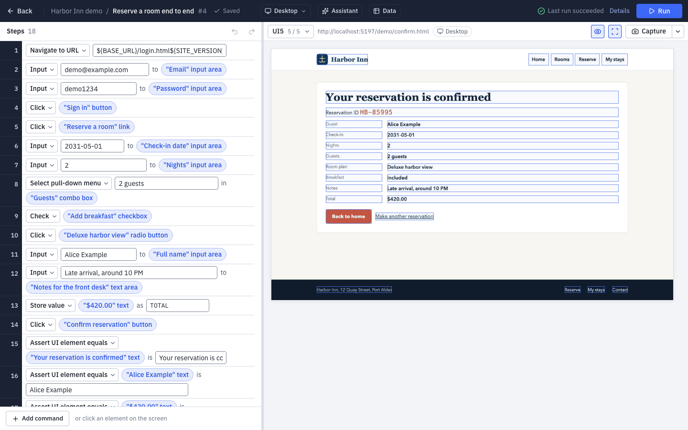
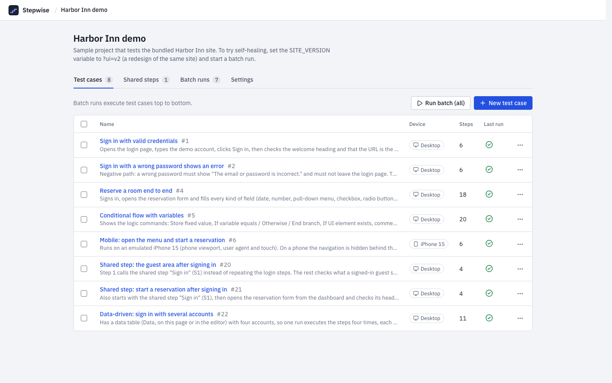
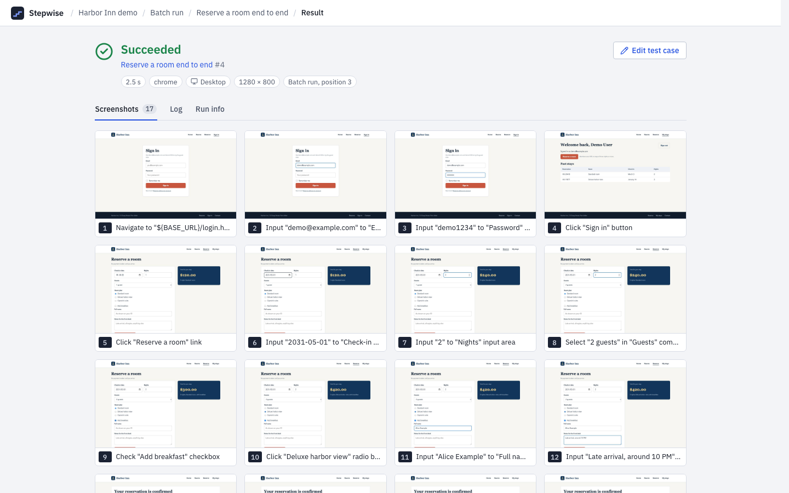
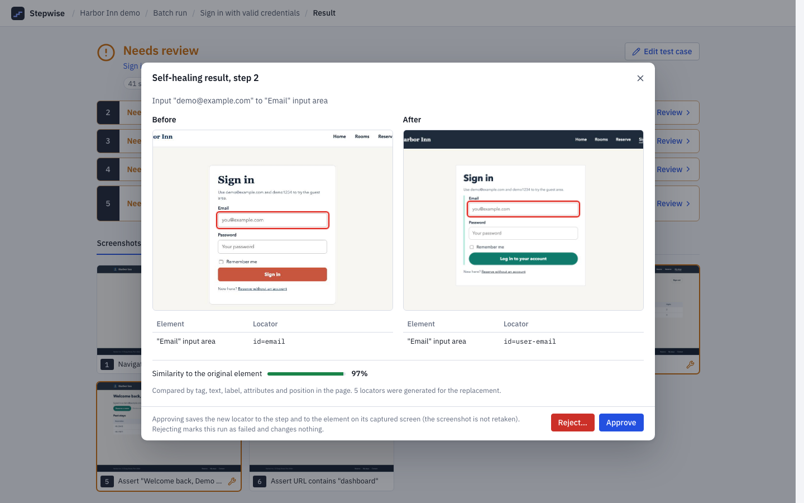
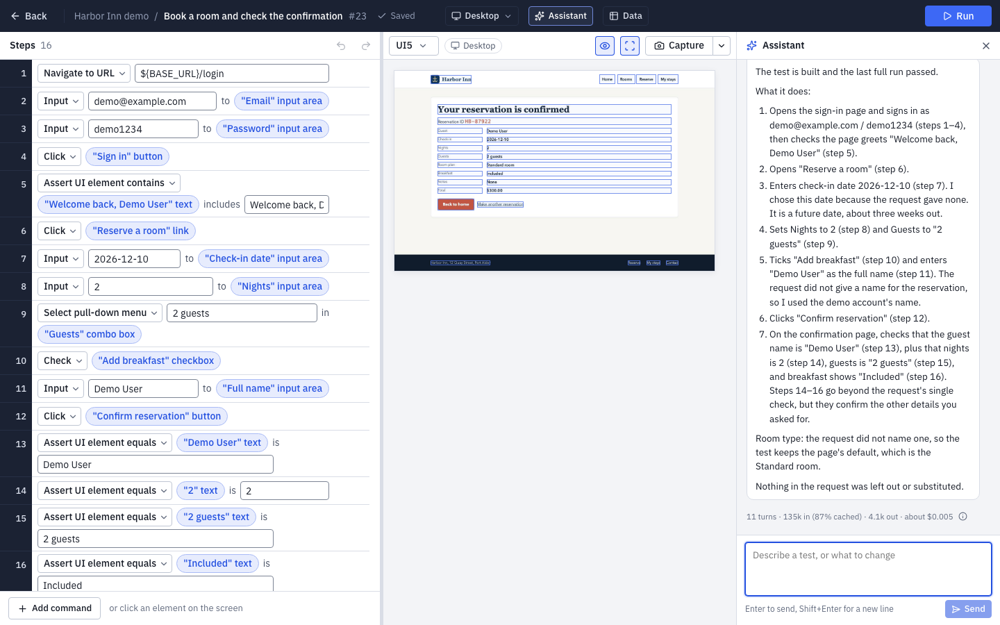

# Stepwise

[](https://github.com/leaker/stepwise/actions/workflows/ci.yml)
[](LICENSE)

A no-code browser test automation demo that runs entirely on Cloudflare Workers. Capture a screen of the
site under test, click the detected UI elements to build steps, run the test in a real browser, read a
per-step report with screenshots, and review locator repairs when the site changed.

It is a portfolio project, not a product: an original implementation written after studying the public
documentation of a commercial no-code test automation tool, to see how much of that workflow fits on the
Workers platform. It is not affiliated with, endorsed by, or derived from the code of any such product.

**Live demo:** https://stepwise.keworks.dev (access code available on request)



## What it does

- **Capture** a page in a real Chromium and get its UI elements with several ranked locators each.
- **Build steps without code** by picking elements on the capture; 31 commands, If / Otherwise / End
  branches, variables, shared steps and data-driven runs. [Details](docs/features.md)
- **Run** single test cases or whole projects in the background (Queues), on desktop or an emulated phone,
  and trigger batch runs from CI over HTTP.
- **Self-heal**: when a locator no longer matches, the engine finds the closest element, continues, and
  marks the run *unresolved* until a person approves or rejects the repair. [Walkthrough](docs/examples.md)
- **AI assistant** (optional): describe a test in plain language and the assistant captures pages, adds
  steps, runs them and checks the result against your request before it reports.
  [Design and benchmark](docs/ai-assistant.md)

| Project overview | Run report |
| --- | --- |
|  |  |



## Stack

TypeScript everywhere. React 19 + Vite on the front end, Hono on a Cloudflare Worker, D1 (SQL), R2
(screenshots), Queues (runs) and Browser Run with `@cloudflare/playwright` (the browser). The AI assistant
uses the Claude API through the official SDK. Tests run on Vitest against a real headless Chromium.
[Architecture and engine](docs/architecture.md)

## Quick start

```sh
pnpm install
pnpm db:migrate:local     # local D1 database and the demo project
pnpm dev                  # http://localhost:5173
```

Browser Run, D1, R2 and Queues are simulated locally. `pnpm typecheck` and `pnpm test` check the code.
Optional settings (`ACCESS_CODE`, `ANTHROPIC_API_KEY`, `ALLOWED_HOSTS`), deployment and the CI snippet are in
[docs/development.md](docs/development.md).

## AI assistant in numbers



The assistant is measured, not just demonstrated: 18 tasks against the bundled sample site, checked on the
resulting steps rather than on the model's own report. The default model passed 54 of 54 runs at about
$0.003 per session; larger models passed 18 of 18 at roughly 12 to 26 times the median cost per session. The guards that make it
reliable (every tool call validated, a session cannot end with steps that were not run) and the
prompt-injection limits are described in [docs/ai-assistant.md](docs/ai-assistant.md).

## Documentation

| Document | What is in it |
| --- | --- |
| [Features](docs/features.md) | Every feature in detail: shared steps, data tables, devices, batch runs, reports |
| [Architecture and engine](docs/architecture.md) | Request flow, queue and time limits, detection, locator ranking, self-healing |
| [Walkthrough and example suite](docs/examples.md) | Trying self-healing step by step; the eight seeded test cases |
| [AI assistant](docs/ai-assistant.md) | Tools, guards, finishing gate, safety limits, model benchmark and cost |
| [Development and deployment](docs/development.md) | Local setup, settings, deploy commands, triggering a batch run from CI |
| [Modern web practices](docs/modern-web.md) | Accessibility, security headers, performance and cross-browser findings |
| [Limits and non-goals](docs/limits.md) | What it does not do, and the limits it enforces |

## Limits

One browser type (Chromium), no real devices or native apps, no users or roles, and self-healing is a
similarity heuristic that always needs a human decision. The full list is in [docs/limits.md](docs/limits.md).

## License

[MIT](LICENSE) © 2026 LI KE
